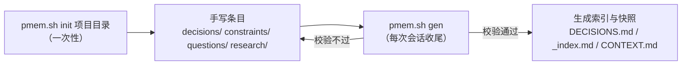

# project-memory-kit

Scaffold a **project-memory** layer in any repository, and keep its indexes generated instead of hand-written.
用一条命令在任意项目里建出「项目记忆层」，并让它的索引由脚本生成而不是手写。

面向 AI 编码代理（Claude Code / Codex / Cursor 等）的跨会话项目记忆：把「这个项目定过什么」变成一堆**只增不改的文件**加**自动生成的索引**，从而消除两个会话互相覆盖、以及索引膨胀到读不完这两类故障。

- 设计说明（为什么是这样）：见 [My-Skill](https://github.com/arsonist-g/My-Skill) 的 `project-memory/spec/memory-layer-design.md`
- 证据链（为什么不是别的样子）：见同仓 `project-memory/research/project-memory/`

---

## 它解决什么

| 故障 | 现象 | 本工具的做法 |
|---|---|---|
| 两个会话互相覆盖 | A 写「用 PostgreSQL」，B 改回「MySQL」，A 再改回，无限循环 | 决策只能**新增文件**；索引是生成物，没人手改，也就没人覆盖 |
| 索引膨胀 | 索引行数 = 决策条数，最终撑爆上下文 | 索引只登记**域**一行，不随条目数增长；条目靠 grep |
| 分歧无解 | 两个代理都认为自己对 | 提供 `supersedes` / `superseded-by` 双向校验，分歧必须显式落成两条记录，交给人裁决 |

三条不变量：

1. **手写的只能是「新增」，不能是「汇总」**——条目手写，索引与快照由脚本生成。
2. **索引只登记入口，不登记全体**——顶部表按域一行；进域之后靠 grep，不靠读索引。
3. **分歧只能显式挂起，不能覆盖**——禁止改别人的条目。

---

## 安装

两个脚本，功能等价，各自独立：

| 平台 | 文件 |
|---|---|
| Linux / macOS / **Windows + Git Bash** | [`pmem.sh`](pmem.sh) |
| Windows PowerShell 7（或 5.1） | [`pmem.ps1`](pmem.ps1) |

克隆本仓即可，脚本无第三方依赖：

```bash
git clone https://github.com/arsonist-g/project-memory-kit.git
```

---

## 用法



### 1. 建骨架（每个项目一次）

```bash
bash project-memory-kit/pmem.sh init /path/to/your/project
```

它会在 `<项目>/project-memory/` 下建出完整结构，并把两个脚本装进 `<项目>/project-memory/scripts/`——之后的日常使用不再依赖本仓。

```text
project-memory/
├── CONTEXT.md            现状快照（生成 + 一个手写块），每会话读，≤100 行
├── DECISIONS.md          入口表（生成）：域路由 + 活约束全文 + 开放问题一行
├── decisions/<域>/       决策本体，按域分目录
│   ├── _about.md         手写：本域一句话范围（路由表要用）
│   ├── _index.md         生成：本域索引
│   └── DEC-NNN-slug.md   手写：每条一个文件，不可变
├── constraints/          手写：活约束（必须始终成立）
├── questions/            手写：开放问题
├── research/<主题>/      手写：调研与验证报告，只读归档
├── spec/                 设计产出
├── task-tracker/         编码任务条目与进度
└── scripts/pmem.{sh,ps1} 本工具的副本
```

### 2. 写条目

每条决策一个文件。前 20 行是机器可读的 front-matter，grep 就靠它：

```markdown
---
id: DEC-012
title: 用 JWT 短令牌 + 刷新令牌
status: accepted          # proposed | accepted | superseded | deprecated
date: 2026-10-13
summary: 鉴权用 JWT 短令牌，不用服务端 session
tags: [auth, api]
supersedes: []
superseded-by: []
evidence: [research/auth/token-strategy]
---

## 决策
（正文）
```

`id` **永不复用**：决策被推翻时，旧文件留着、`status` 改成 `superseded`、`superseded-by` 填新 ID。

### 3. 生成索引（每次会话收尾）

```bash
bash project-memory/scripts/pmem.sh gen /path/to/project/project-memory
```

先校验，**校验不过就拒绝写入**（退出码非零），所以它可以直接挂 pre-commit 或 CI。

---

## 命令

| 命令 | 作用 |
|---|---|
| `pmem.sh init [目录]` | 建骨架（默认当前目录） |
| `pmem.sh gen [pm 目录]` | 校验并重算索引与快照（默认 `./project-memory`） |
| `pmem.sh check [pm 目录]` | 只校验，不写文件；有问题则以非零退出 |

环境变量：

| 变量 | 默认 | 作用 |
|---|---|---|
| `PMEM_INDEX_MAX` | `150` | 某域条目超过这个数，该域索引退化成「别读我，直接 grep」的提示 |
| `PMEM_RAW_BASE` | 本仓 main 分支的 raw 地址 | `init` 无法确定脚本自身位置时（例如 `curl \| bash`）从这里下载 |

---

## 五项校验

`check` 与 `gen` 都跑，任一条不过即非零退出：

1. 条目 `id` 不重复
2. front-matter 必填字段齐全、`status` 取值合法
3. `supersedes` / `superseded-by` 双向一致（A 说取代 B，B 必须说被 A 取代）
4. `evidence` 引用的路径存在
5. `CONTEXT.md` 行数 ≤ 100

此外还有两条结构约束：每个域必须有 `_about.md`（提供路由表里的「涵盖」一句话）；条目文件里**不许**写 `domain` 字段——域由所在目录决定，同一个事实存两处必然漂移。

---

## 为什么不把它做成数据库 / 向量库 / 知识图谱

对「数百到数千条、短、结构化、带唯一 ID」的条目，词法匹配（grep）是精确且零维护的；向量检索与图索引都是**需要与真源同步的第二份状态**，会引入新的不一致面。有独立评测显示 GraphRAG 在许多真实任务上不及朴素 RAG。量级到了再说，触发条件写在设计文档里。

同理，**索引撑大时不要递归拆索引**：目录分层是免费的，索引文件是昂贵的，grep 是便宜的。域内条目多到索引读不完时，直接不读它。

---

## 开发

```bash
bash tests/run-tests.sh        # 语法 + 冒烟 + 五项校验负例 + 两实现产出一致性
```

改了 `pmem.sh` 必须同步改 `pmem.ps1`，并保证两者在同一输入上产出逐字节相同的文件。`tests/run-tests.sh` 会核对这一点。

`examples/demo/` 是一份填好的最小记忆层，可以当作形状参照（它不含 `scripts/`，那是 `init` 时才会装进去的）。

---

## License

MIT
